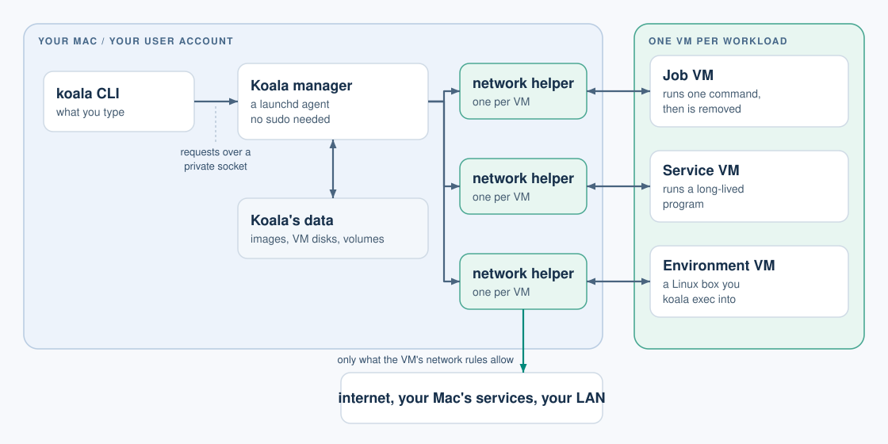

# Koala user guide

This guide matches Koala 0.1.0-rc.3. The latest release is on the [releases page](https://github.com/kunalkushwaha/homebrew-koala/releases).

This guide is for developers who use the `koala` command line, on a Mac or
on a Linux machine. It explains how to run jobs, services, development
environments and AI agents in Koala VMs. The commands are the same on both;
the pages show a Mac, and [Koala on Linux](linux.md) covers what differs.
The latest release is `0.1.0-rc.3`, the third release candidate for Koala
0.1.0.
This guide describes what works today.

## What Koala is

Koala runs each of your Linux workloads in its own lightweight virtual
machine, on your Mac or on a Linux machine:

- **One VM per environment.** Each job, service or development environment
  gets its own Linux VM (ARM64 on a Mac, x86-64 on Linux), with its own
  kernel, disk and network stack.
  VMs do not share a network with each other.
- **A CLI and a background manager.** You type `koala` commands. A per-user
  manager (a launchd agent on a Mac, a systemd user service on Linux) keeps
  track of VMs and keeps them running after your terminal closes. No `sudo` is needed for everyday use.
- **Two guest profiles.** *Lean* VMs run one OCI image (a Docker-style
  image) with a minimal init. *Full* VMs run a Linux distribution with
  systemd and Docker Engine.
- **Agents with their keys outside the VM.** An AI agent's API keys can
  stay on your computer (in the login keychain on a Mac, in the broker's
  own encrypted files on Linux): the [broker](broker.md) adds a key only to the
  requests a policy allows, so the key never enters the VM. A
  [VM template](templates.md) sets an agent up in one command, as in
  `koala create hermes --template hermes`.

Each VM has its own kernel and disk, and a network helper on the host that
checks every connection it makes.

## What Koala promises, and what it does not

Koala gives a workload **only the access you grant**:

- No host files, except directories you share explicitly. Shares are
  read-only unless you ask for read-write.
- No secrets, unless you grant a named secret to that VM.
- Internet access by default, but no access to your Mac's own services, your
  LAN or other VMs unless you grant it (internet can also be switched off).
- Published ports listen on `127.0.0.1` unless you ask for the LAN.

The VM, its guest kernel and everything running inside it are treated as
untrusted. Koala does **not** promise:

- To keep running after you log out of macOS, or across a reboot. See
  [limits](limits.md).
- To protect you from a compromised macOS, or from yourself: Koala trusts
  the logged-in user.
- That data the guest has already received can be taken back. Removing a
  secret or a share stops future access only.
- Dedicated CPU cores or a cap on total Mac memory use. See
  [limits](limits.md#memory-cpu-and-disk).

Koala is tested against a hostile guest, its broker
against leaked keys, and its manager, VM processes and
helpers by crashing them at chosen points, on real
VMs on both platforms.

## Requirements

On a Mac:

- A Mac with Apple silicon.
- macOS 26 or newer.
- Images for `linux/arm64`. Intel (x86-64) images are not supported, and
  there is no Rosetta translation.

On Linux: Ubuntu 24.04 on x86-64 with kernel 6.12 or newer, access
to `/dev/kvm`, and images for `linux/amd64`. See
[Koala on Linux](linux.md#requirements).

## Get started

1. [Install, upgrade and remove](getting-started.md): install Koala on a Mac,
   start it, and check it's ready. On Linux, see [Koala on Linux](linux.md).
2. Then follow the tutorials below, starting with Tutorial 1.

## Tutorials

Learn by doing, in order. Each tutorial uses real commands and shows their
real output, leaves your computer as it found it, and is tested by running
it exactly as written.

1. [Your first VM](tutorial-first-vm.md): run a command in a throwaway VM,
   make a VM that stays, work in it, and remove it (about five minutes).
2. [Run an AI agent safely](tutorial-agent.md): the Hermes agent from a
   template, its model through the broker, internet off, and how to check
   what it can't reach (about fifteen minutes).
3. [Give a VM your data, not your Mac](tutorial-data.md): copy files in and
   out, share a folder read-only, and keep data on a volume (about ten
   minutes).
4. [Decide what an agent can reach](tutorial-policy.md): write a broker
   policy, check and test it, and allow one refused request but not another
   (about fifteen minutes).
5. [Secrets and keys](tutorial-secrets.md): a secret the VM gets, and a key
   it never gets (about ten minutes).
6. [Services and ports](tutorial-services.md): a web server you open from
   your Mac, and one Mac service for a VM with no internet (about ten
   minutes).
7. [Look after your VMs](tutorial-look-after.md): logs, stats and events; following and
   cancelling long work; changing a VM; tidying images (about fifteen
   minutes).
8. [Images, registries, and a full Linux with Docker](tutorial-images.md):
   images ahead of time, lean and full VMs, Docker without Docker Desktop,
   and a private registry (about fifteen minutes).

## Guides

How each part of Koala works, and how to do things with it, by topic.

- [Jobs and VMs](vms.md): jobs, services and environments, VMs from a file,
  resources, and the VM lifecycle.
- [Working inside a VM](working-in-vms.md): `exec`, terminals (`-it`),
  `attach`, `cp`, logs, the console, events and exit codes.
- [Images and private registries](images.md): `image pull`, the image cache,
  and `registry login` and `logout`.
- [Shares, volumes and disks](storage.md): host folders, named volumes and
  disk sizes.
- [Networking](networking.md): internet access, services on your Mac, the
  LAN and published ports.
- [Secrets](secrets.md): `secret set`, file and variable delivery, and the
  keychain.
- [Keys on your Mac (the broker)](broker.md): credentials, policies and
  grants, so an agent's API keys never enter its VM.
- [VM templates for agents](templates.md): an agent's VM, keys, volumes and
  setup in one command.
- [Profiles: lean and full](profiles.md): systemd and Docker in a full VM.

## Examples

Real agents, set up end to end.

- [Run the Hermes agent](example-hermes.md): beyond Tutorial 2, with the
  gateway's API, its key, and chat platforms.
- [Run OpenClaw](example-openclaw.md) (tested on Linux and macOS): the
  OpenClaw gateway from its official image, with one script, internet off
  and its model key on your computer.
- [An X agent](example-x-agent.md): a normal browser in a VM that you sign
  in to through a live view, and an agent that reads X, drafts with a model,
  and posts only what you approve.

## Reference

- [The broker policy file](policy-file.md): every field of a policy, minted
  tokens, and the rules no policy can change.
- [Troubleshooting](troubleshooting.md): error codes and what to do.
- [Limits and behaviour](limits.md): logout, sleep, restarts, memory and
  disk.
- [Koala on Linux](linux.md): requirements, the Debian package, logging out,
  upgrading and removing on Linux.
- `koala --help` lists every command, and `koala COMMAND --help` shows one
  command's usage, options and examples.

## Conventions in this guide

- `VM` is a VM's name or ID. A name must match exactly; if two VMs share a
  name, use the ID.
- Upper-case words such as `EXECUTION_ID` or `REGISTRY` are placeholders.
- Commands that change something accept `--wait`, so they return only when
  the change is finished. The examples use it. Without `--wait`, the command
  returns as soon as the manager has accepted the request.
- `--json` prints machine-readable output on stdout. Messages go to stderr.
