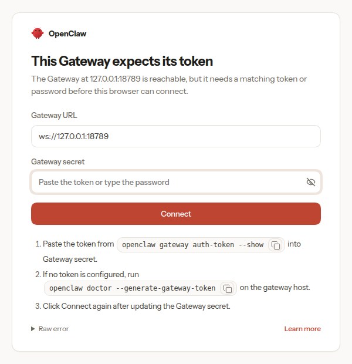
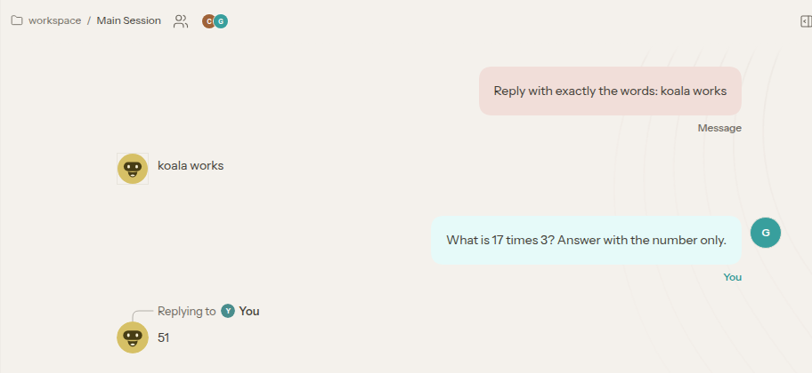

# Example: run OpenClaw

[User guide](README.md) > Example: run OpenClaw

> **Tested on Linux and macOS** (2026-10-26): Koala 0.1.0-preview.14 on
> Linux and 0.1.0-preview.15 on an Apple silicon Mac, OpenClaw 2026.10.7
> (`ghcr.io/openclaw/openclaw:latest`), with a local OpenAI-compatible model
> in place of OpenAI's. Everything on this page ran as written on both, and
> the browser didn't need approving on either. A newer OpenClaw may change
> its onboarding or its Control UI: see
> [If something doesn't work](#if-something-doesnt-work).

[OpenClaw](https://openclaw.ai) is a personal AI assistant. Its gateway
connects a model to chat apps and runs tools. This page runs the gateway
in a Koala service VM:
- with no internet access;
- with its model key on your computer, reached through the [broker](broker.md);
- with its state on a volume;
- with its Control UI on your computer's `127.0.0.1`.

The agent's tools run inside the VM, so they reach only what the VM is
granted.

> **Two configurations, kept apart.**
> - **Koala's: the VM.** Its image, resources, network, grants, volume and
>   secret are set by `openclaw.sh up` with `koala create` flags. `koala
>   inspect claw` shows them, and `koala edit claw` changes them.
> - **OpenClaw's: `openclaw.json`, inside the VM,** on the volume. OpenClaw
>   writes it with its own command, `openclaw onboard`, and changes it with
>   `openclaw config set`. Koala never reads or writes this file. The VM's
>   start command, `vm/start.sh`, only runs OpenClaw's command once, on the
>   first start.

## What OpenClaw's image needs

From [OpenClaw's Docker guide](https://docs.openclaw.ai/install/docker) and
its image:

- **The image** is `ghcr.io/openclaw/openclaw`, for `linux/arm64` too. It
  runs OpenClaw as the user `node` (uid 1000), from `/app`.
- **Everything it keeps** is in `/home/node/.openclaw`: its configuration
  (`openclaw.json`), sessions, memory, installed skills and credentials.
  - It must persist as a directory, so it goes on a volume.
  - A new volume may not be writable by `node`. So the VM starts as root,
    gives that directory to `node`, then runs OpenClaw's own entrypoint as
    `node`.
- **The gateway refuses to start** until its configuration sets
  `gateway.mode` to `local`.
  - To be reached through a published port, it must listen on the VM's
    network (`--bind lan`), and then it requires a token.
  - On the first start, the VM runs OpenClaw's own non-interactive
    onboarding, which writes `openclaw.json`.
  - The token comes from a Koala [secret](secrets.md), as
    `OPENCLAW_GATEWAY_TOKEN`.
- **The model** is reached as a
  [custom provider](https://docs.openclaw.ai/concepts/model-providers/custom-providers):
  an OpenAI-compatible `baseUrl`, here the broker.

## Get the example

The files are in the `examples/openclaw` folder of Koala's Homebrew tap.
Copy it to a folder of your own: the VM reads this folder.

On a Mac, Homebrew already keeps the tap. Choose a folder outside Desktop,
Documents and Downloads, which macOS protects:

```sh
cp -R "$(brew --repository kunalkushwaha/koala)/examples/openclaw" ~/openclaw
cd ~/openclaw
```

On Linux, clone the tap:

```sh
git clone --depth 1 https://github.com/kunalkushwaha/homebrew-koala ~/koala-tap
cp -R ~/koala-tap/examples/openclaw ~/openclaw
cd ~/openclaw
```

| File | What it is |
| --- | --- |
| `openclaw.sh` | The commands on this page. They use the `koala` CLI. |
| `vm/start.sh` | The VM's main command, run as root, shared into the VM read-only. |

## Start it

```sh
./openclaw.sh up
```

It asks for your model provider's API key, which stays on your computer. It
prints the gateway token once: keep it, for example in your password
manager. The Control UI asks for it, and Koala doesn't show it again.

- `up --model M` picks another model.
- `up --origin URL` picks another OpenAI-compatible provider, as on the
  [Hermes page](example-hermes.md#store-the-model-key-on-your-mac).
- `up --port N` publishes the Control UI on another port.

**What `up` does with Koala:**
1. `koala policy create claw-openai --template openai --model …`: the
   key on your computer, for that model only.
2. `koala secret set claw-gateway-token`: a random gateway token.
3. `koala volume create claw-state`: OpenClaw's state.
4. `koala create claw …`, with flags:
   - the image, run as root from `/app`, with `vm/start.sh` as its command;
   - internet off, and the broker grant `openai`;
   - the Control UI published on `127.0.0.1:18789`;
   - the volume at `/home/node/.openclaw`;
   - the token as `OPENCLAW_GATEWAY_TOKEN`;
   - this folder, read-only, at `/openclaw`.

   `koala create` prints all of that first.
5. `koala start claw`, then it waits until the gateway's `/healthz`
   answers inside the VM. The first start downloads the image, about
   1.3 GB.

Each step that exists already (the policy, the token, the volume) is reused.

**What `vm/start.sh` does in the VM**, as root:
1. It gives the volume to `node`.
2. On the first start only, it runs OpenClaw's
   [non-interactive onboarding](https://docs.openclaw.ai/cli/onboard) as
   `node`. This writes OpenClaw's configuration:
   - local mode, listening on the VM's network;
   - the gateway token from `OPENCLAW_GATEWAY_TOKEN`;
   - your model, through the broker, as an OpenAI-compatible provider. Its
     key is `koala-brokered`, a placeholder that the broker replaces.
3. It allows the Control UI's address on your computer, with `openclaw config
   set`.
4. As `node`, it runs OpenClaw's own entrypoint with the gateway.

After the first start, the configuration is OpenClaw's. Change it with
OpenClaw's own commands, such as `openclaw config set`.

## Open the Control UI

Open `http://127.0.0.1:18789`, paste the gateway token into **Gateway
secret**, and choose **Connect**:



Then the Control UI opens. Messages go to your model through the broker:



In the run on Linux, signing in with the token was enough: OpenClaw paired
the browser at once. If OpenClaw asks for the device to be approved instead,
approve it from the VM:

```sh
./openclaw.sh approve             # the devices paired, and those waiting
./openclaw.sh approve REQUEST_ID  # approve yours
```

These run OpenClaw's `devices list` and `devices approve` in the VM, as the
user that owns its state. The browser stays paired after the VM restarts,
and after `down` and `up`, since its pairing is on the volume.

## Stop or remove it

```sh
./openclaw.sh logs                # the gateway's output
./openclaw.sh down                # remove the VM; its state stays on the volume
./openclaw.sh down --forget       # also remove the volume, the token and the policy
```

Your API key stays stored after `down --forget`. `koala credential rm
claw-openai` removes it.

## Chat apps

OpenClaw's chat channels, such as Telegram, Discord and Slack, connect to
their services directly, so the VM needs internet access and the channel's
own token. To give it those:

1. Store the channel's token as a secret, for example
   `koala secret set claw-telegram-token`.
2. Stop the VM, and run `koala edit claw`:
   - set `"internet"` to `true`, and keep the broker grant if the model
     should still use it;
   - add the token to `"secrets"`, for Telegram's default account as
     `{"name": "claw-telegram-token", "mode": "environment", "variable":
     "TELEGRAM_BOT_TOKEN"}`.
3. Start the VM, and set the channel up as
   [OpenClaw's channel pages](https://docs.openclaw.ai/gateway/config-channels)
   describe.

With internet on, the agent can send anything it reads anywhere.

## If something doesn't work

This page ran as written with OpenClaw 2026.10.7. A newer OpenClaw may
change these parts, and this is where to look:

| Part | What to check |
| --- | --- |
| The start: `setpriv`, `tini` and `/app/docker-entrypoint.mjs`, from the image as documented | `./openclaw.sh logs`. If the gateway exits at once, the VM stops; `koala inspect claw` says why. |
| The volume's owner | If OpenClaw can't write `/home/node/.openclaw`, check with `koala exec claw -- ls -ld /home/node/.openclaw`. |
| The onboarding flags, from OpenClaw's `onboard` reference for 2026.10 | If onboarding fails, the VM stops, and `./openclaw.sh logs` shows OpenClaw's message. An invalid configuration exits with code 78. To start over, run `./openclaw.sh down --forget`, then `up`. |
| `openclaw config set --batch-json`, for the Control UI's address | If the start stops there, see the logs. With the default port, the line can be removed from `vm/start.sh`. |
| Requests to the model | The `openai` policy allows chat completions and the model list for the one model. If OpenClaw asks for more, the broker refuses with `"source":"koala-broker"`. `koala policy status` shows the counts, and `koala policy inspect claw-openai` what is allowed. |
| The devices commands | They may need the gateway token: run `koala exec --user node claw -- openclaw devices list --token TOKEN`. |

If you need to change something, it's worth reporting. A built-in
template follows once OpenClaw has run from one on a real VM, so that
OpenClaw becomes `koala create claw --template openclaw`, as
[Hermes](templates.md) is.

## Keys and what the agent can reach

- **With the broker,** the model key never enters the VM. OpenClaw can use
  it only for the requests the policy allows, within its limits.
- **The gateway token** is in the VM, as `OPENCLAW_GATEWAY_TOKEN`. Anyone
  with it can use the Control UI, which is published on `127.0.0.1` only.
- **Everything OpenClaw keeps** stays on the `claw-state` volume, and
  remains after the VM is deleted, including any OAuth tokens it stores.
  `koala volume rm claw-state` removes it.
- Leave OpenClaw's own sandbox off: it needs Docker, which a lean VM does
  not have. The VM is the sandbox.

Sources: OpenClaw's [Docker install](https://docs.openclaw.ai/install/docker),
[gateway](https://docs.openclaw.ai/cli/gateway/running),
[gateway configuration](https://docs.openclaw.ai/gateway/config-gateway),
[custom providers](https://docs.openclaw.ai/concepts/model-providers/custom-providers),
[network exposure](https://docs.openclaw.ai/gateway/security/network-exposure)
and [VM runtime](https://docs.openclaw.ai/install/docker-vm-runtime) pages,
and the [Dockerfile](https://github.com/openclaw/openclaw/blob/main/Dockerfile)
and [Kubernetes manifests](https://github.com/openclaw/openclaw/tree/main/scripts/k8s/manifests)
in its repository.
