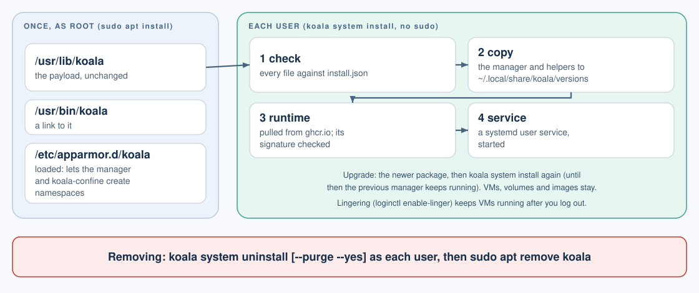
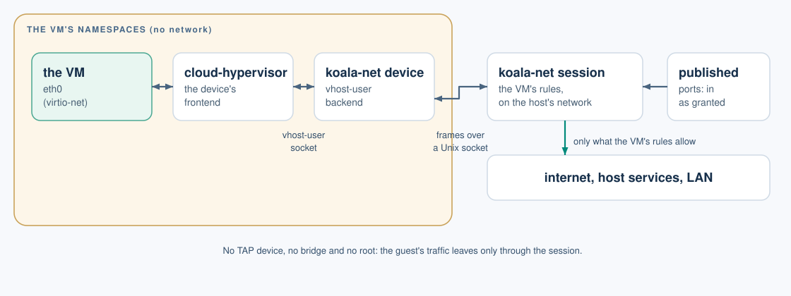

# Koala on Linux (preview)

[User guide](README.md) > Koala on Linux

Koala runs on Linux hosts as a preview. Each VM runs on KVM with Cloud
Hypervisor, instead of macOS's Virtualization framework. The `koala`
commands and their output are the same as on a Mac. This page covers what
differs: requirements, installing, upgrading and removing.

## Requirements

- **Ubuntu 24.04 on x86-64**, with **kernel 6.12 or newer**, for
  Landlock ABI 6. Ubuntu 24.04's hardware-enablement kernel has it:

  ```sh
  sudo apt install linux-generic-hwe-24.04   # then restart
  ```

- **Access to `/dev/kvm`.** Add yourself to the `kvm` group, then log out
  and in again:

  ```sh
  sudo usermod -aG kvm "$USER"
  ```

- **A systemd user session**, which a desktop or SSH login gives. Koala's
  manager is a systemd user service.
- **Images for `linux/amd64`.** Images are pulled for the host's
  architecture.

`koala system check` checks each of these and prints the command that fixes
anything missing:
- your user;
- the kernel and Landlock;
- `/dev/kvm`;
- cgroup delegation and memory pressure;
- the user session.

It also reports where VMs are stored and which secret store Koala will
use. Run it first:

```sh
koala system check
```

## Installing



With the Debian package, from the release page (check its checksum against
the release notes first):

```sh
sha256sum koala_VERSION_amd64.deb   # compare with the release notes
sudo apt install ./koala_VERSION_amd64.deb
koala system install
```

The package puts Koala in `/usr/lib/koala`, links `/usr/bin/koala` to it,
and installs the libraries it needs. Then **each user** who runs Koala runs
`koala system install`, as themselves, never with `sudo`. It:
- checks every file of the package against its `install.json`;
- copies the manager and helpers into `~/.local/share/koala/versions/VERSION/`;
- downloads the lean runtime and verifies its signature against the
  release keys;
- writes `~/.config/systemd/user/koala-manager.service`, and starts it.

Or use the release archive, which needs the libraries the release notes
list:

```sh
sha256sum koala-VERSION-linux-amd64.tar.gz   # compare with the release notes
tar -xzf koala-VERSION-linux-amd64.tar.gz
koala-VERSION/bin/koala system install
```

Keep the extracted folder: the `koala` command runs from it.

## Networking

A VM's network works as on a Mac: the internet by default, and your
computer's services, the LAN and published ports only as you grant them
([Networking](networking.md)). On Linux the VM's processes have no network
of their own; its traffic leaves only through its network session, which
applies its rules. No TAP device, bridge or root is needed.



## Logging out

The manager is a user service, so systemd stops it, and your VMs, when you
log out, unless lingering is on. To keep VMs running after you log out, as
on a server or a CI host:

```sh
sudo loginctl enable-linger "$USER"
```

## Secrets

`koala system install` chooses where secrets and registry logins are kept:
- **your login keyring** (GNOME Keyring, or any Secret Service), when your
  session has one;
- otherwise **encrypted files** in `~/.local/share/koala/secrets`, with
  their key in `~/.config/koala`, readable only by you.

The broker's credentials are always in its own encrypted files. A VM can
never share these directories: `koala create --mount` refuses them.

## Upgrading

Install the newer package, then run `koala system install` again as each
user:

```sh
sudo apt install ./koala_NEWVERSION_amd64.deb
koala system install
```

Until you do, the previous manager keeps running. Your VMs, volumes and
images are kept. If VMs are running, `koala system install` refuses and
changes nothing; add `--stop-vms` to stop them first.

## Removing

Each user removes their installation first, then the package goes:

```sh
koala system uninstall                # keeps VMs, volumes, images and runtimes
koala system uninstall --purge --yes  # deletes them too, and stored secrets
sudo apt remove koala
```

If the package goes first, each user's manager keeps running from
`~/.local/share/koala` until that user runs the uninstall from a release
archive.

## What is not done yet on Linux

- Helpers get their own user, PID and mount namespaces, with a private
  `/proc`, only where Koala's AppArmor profile is loaded (from
  0.1.0-preview.13; the `.deb` installs and loads it). Without it, as with
  an archive install, each helper is still confined with Landlock and
  seccomp, but can see other processes' `/proc` entries. `koala system
  check` says which.
- The network session with a VPN, Wi-Fi changes and sleep, tested on a
  real machine.
- Install, upgrade and removal were tested on a clean Ubuntu 24.04 system
  in a container with systemd and KVM, not yet on a desktop login.
